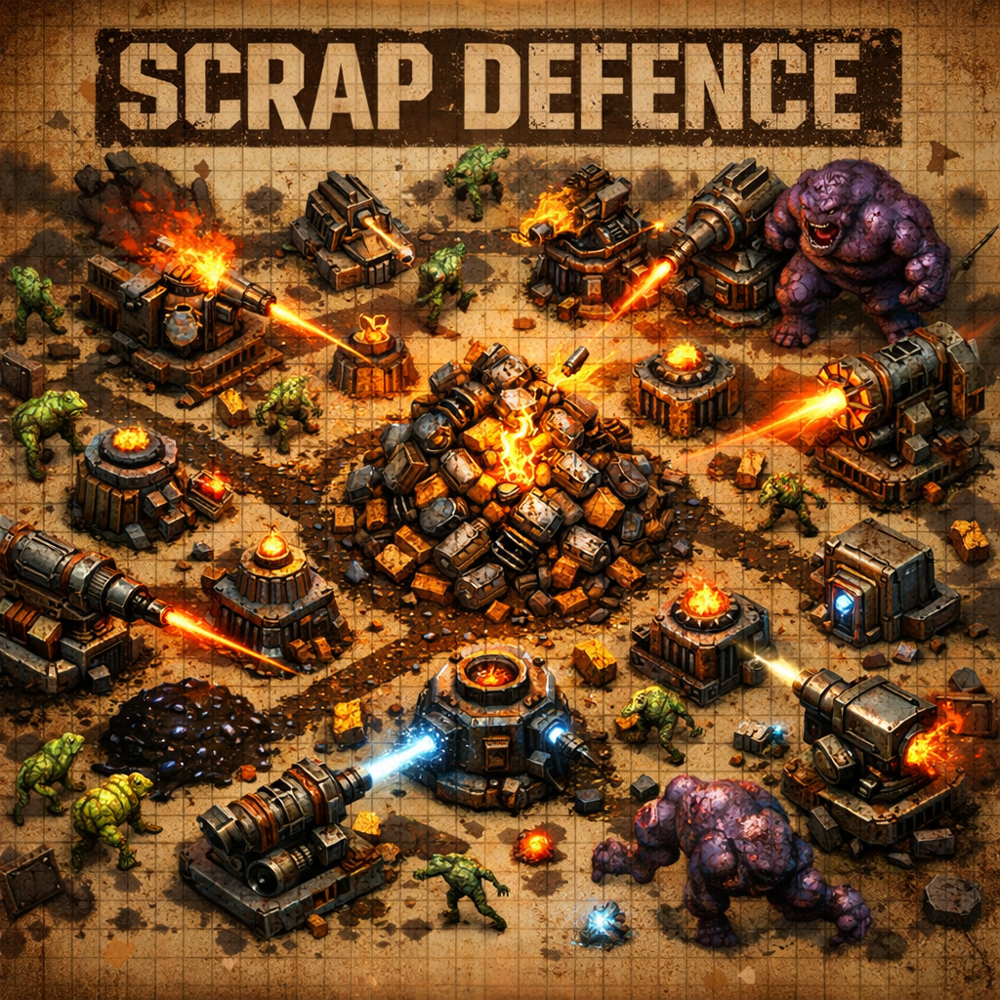

# Scrap Defence - Gameplay Guide

A post-apocalyptic tower defense where you defend your scrap pile from waves of mutants on a procedurally generated open field. No fixed paths — you maze the enemies with your towers.

Two game modes are available from the main menu:
- **Classic Mode** (SPACE) — 20 waves with building phases between each
- **Endless Mode** (E) — Continuous survival with escalating difficulty (see [Endless Mode](#endless-mode) below)

## The Basics (Classic Mode)

You start with **250 scrap** and a pile in the center of the map. Enemies spawn from the edges and path toward your pile. If they reach it, they **steal scrap and flee**. If your pile hits zero and there's no scrap left anywhere, it's game over.

The game alternates between two phases:

- **Building** — Plan your maze between waves. Press **Enter** to start the next wave.
- **Defending** — Towers fire automatically. The wave ends once every enemy has spawned, no enemy is left (killed or escaped), and no scrap drop is left (collected or expired).

You can place, sell, upgrade, and repair towers in either phase.

There are **20 waves** of increasing difficulty. Clear the last one and the run ends on a **YOU SURVIVED** screen.

## Controls

| Input | Action |
|-------|--------|
| **1-7** | Select tower type |
| **Left Click** | Place selected tower / Inspect placed tower |
| **Left Click** (targeting button) | Set the inspected tower's targeting mode |
| **Right Click** | Sell tower (60% refund) |
| **U** | Upgrade inspected tower |
| **M** | Upgrade magnet tier (inspection) |
| **L** | Upgrade reload (inspected Mortar) |
| **R** | Repair inspected tower |
| **Escape** | Close inspection / Deselect tower |
| **Escape x2** | Quit game (desktop only; confirmation banner appears after first press) |
| **F11** | Toggle fullscreen (desktop only) |
| **Tab** | Toggle HUD panels on/off |
| **Enter** | Start next wave (Building phase) |
| **Space** | Return to main menu (end-of-run screen) |
| **Scroll Wheel** | Zoom in/out |
| **Middle Mouse Drag** | Pan camera |
| **Home** | Reset camera |

## Towers

Towers block enemy pathing (except Tar Pit), so placement is how you build your maze. You must always leave at least one path from every map edge to your pile.

| # | Tower | Cost | Damage | Range | Fire Rate | Special |
|---|-------|------|--------|-------|-----------|---------|
| 1 | **Scrap Gun** | 50 | 10 | 80 | 1.0s | Reliable all-rounder |
| 2 | **Tar Pit** | 75 | 0 | 70 | Aura | **Slow** — 40% speed at the center, enemies walk through |
| 3 | **Explosive** | 125 | 25 | 100 | 3.3s | **AOE** — 25 damage in a 70-unit blast radius |
| 4 | **Railgun** | 150 | 50 | 160 | 5.0s | Long range sniper |
| 5 | **Scrap Magnet** | 100 | 0 | 90 | Aura | **Pulls enemies + slows** — 50% speed at the center |
| 6 | **Chain Lightning** | 125 | 20 | 90 | 2.0s | **Chain** — arcs between enemies, 70% falloff |
| 7 | **Mortar** | 200 | 35 | 130 | 3.0s reload | **AOE** — 35 damage in a 90-unit blast radius |

**Tar Pit** is unique — it doesn't block pathing, so you can place it directly on enemy routes. It deals no damage.

**Tar Pit** and **Scrap Magnet** slows are strongest at the tower and fade with distance. An enemy right on a Tar Pit moves at 40% of its speed (a 60% slow), and one right on a Magnet at 50%. At the edge of the range the slow fades to nothing.

**Scrap Magnet** deals no damage but pulls enemies toward it and has the widest scrap collection range of any tower (90 units vs 30 for other towers).

**Chain Lightning** arcs between clustered enemies — each bounce does 70% of the previous hit's damage. Arc range increases with upgrades (60 → 80 → 100 units).

**Mortar** is heavy artillery. Its turret cooldown is only 0.5s, but after every shot it reloads for 3.0s, and the cooldown runs out during the reload — so in practice it fires once per reload. Upgrade the reload with **L** (see [Mortar Reload Upgrades](#mortar-reload-upgrades)).

An **AOE** shot (Explosive, Mortar) hits its target for full damage, and the blast hits the other enemies nearby: full blast damage at the point of impact, falling off to zero at the edge of the radius.

All towers automatically collect nearby scrap drops.

## Tower Upgrades

Click a placed tower (when no tower type is selected) to inspect it. Press **U** to upgrade.

Towers have **3 tiers**. Each upgrade boosts stats and brightens the sprite:

| Tier | Damage | Range | Cooldown | Cost |
|------|--------|-------|----------|------|
| 1 (base) | 1.0x | 1.0x | 1.0x | — |
| 2 | 1.4x | 1.1x | 0.85x (~18% more shots) | 100% of base cost |
| 3 | 2.0x | 1.2x | 0.7x (~43% more shots) | 150% of base cost |

Each tier also scales what the tower has of these:

| Tier | AOE Radius | Slow | Tower HP |
|------|------------|------|----------|
| 1 (base) | 1.0x | 1.0x | 1.0x |
| 2 | 1.15x | 0.85x | 1.4x |
| 3 | 1.3x | 0.7x | 2.0x |

The slow multiplier applies to the enemy's speed multiplier, so lower is a stronger slow: a tier-3 Tar Pit holds enemies at its center to 28% speed instead of 40%.

Selling an upgraded tower refunds **60% of total investment** (base cost + all upgrade costs).

## Magnet Upgrades

Every tower has a scrap collection aura that pulls nearby drops. Press **M** while inspecting a tower to upgrade its magnet tier, increasing collection radius independently from stat upgrades.

| Magnet Tier | Cost | Collection Radius |
|-------------|------|-------------------|
| 0 (base) | -- | 30 units |
| 1 | 25 | 45 units (+50%) |
| 2 | 50 | 60 units (+100%) |
| 3 | 75 | 75 units (+150%) |

**Total investment for max magnet: 150 scrap.**

The **Scrap Magnet** tower has built-in max collection (90 units) and cannot be further magnet-upgraded. Its collection range scales with stat upgrades instead.

Magnet upgrade costs are included in the sell refund calculation (60% of total investment).

## Mortar Reload Upgrades

The Mortar has one more upgrade track of its own. Press **L** while inspecting a Mortar to shorten its reload:

| Reload Tier | Cost | Reload |
|-------------|------|--------|
| 0 (base) | -- | 3.0s |
| 1 | 60 | 2.25s (0.75x) |
| 2 | 120 | 1.5s (0.5x) |

Reload upgrade costs are included in the sell refund calculation too.

## Tower Health and Repair

Enemies can wreck your towers. Every tower except the Tar Pit has hit points: **3x its base cost** (a Scrap Gun has 150 HP, a Mortar 600). Stat upgrades raise max HP (see above). The Tar Pit has no HP, so nothing can damage it.

**Brutes** hit the nearest tower within 30 units for **20 damage every 1.5s**.

A damaged tower works less well — its shots hit for less, it fires slower, and its slow is weaker:

| Tower HP | Strength |
|----------|----------|
| Above 50% | Full |
| 25% to 50% | 0.75x |
| Below 25% | 0.5x |
| 0 | Rubble — stops working |

The sprite darkens as the tower degrades. At 0 HP the tower turns into grey **rubble**: it stops firing, slowing, and collecting scrap, but it still blocks enemy paths. Rubble can't be upgraded until it's repaired.

Press **R** while inspecting a damaged tower to repair it to full HP:

| Tower State | Repair Cost |
|-------------|-------------|
| Damaged | 30% of base cost |
| Rubble | 50% of base cost |

Repairs don't count toward the sell refund — only the placement and upgrade costs do.

## Targeting Modes

Towers with active targeting (Scrap Gun, Explosive, Railgun, Chain Lightning, Mortar) can be set to one of four targeting priorities. Inspect a tower, then click one of the targeting buttons in its panel.

| Icon | Mode | Behavior |
|------|------|----------|
| **C** | **Closest** | Nearest enemy to the tower |
| **L** | **Lowest HP** | Enemy with least current HP *(default)* |
| **H** | **Highest HP** | Enemy with most current HP |
| **F** | **Furthest Along** | Enemy closest to reaching the pile |

The selected mode is shown as a letter on the tower sprite. Targeting persists across Building and Defending phases.

**Tar Pit** and **Magnet** are aura towers that affect all enemies in range — they have no targeting mode.

For **Chain Lightning**, the targeting mode determines which enemy gets hit first. The chain then arcs to the nearest unhit enemies regardless of mode.

## Enemies

| Type | HP | Speed | Loot | Appears |
|------|----|-------|------|---------|
| **Shambler** | 50 | 40 | 10 | Wave 1+ |
| **Runner** | 30 | 80 | 15 | Wave 3+ |
| **Brute** | 150 | 25 | 30 | Wave 6+ |

**Brutes** attack towers on their way to the pile (see [Tower Health and Repair](#tower-health-and-repair)).

Enemies get tougher each wave: **+15% HP** and **+5% speed** per wave. Spawn rate also increases — starting at 1.5s between spawns and dropping by 0.05s each wave, down to 0.6s by wave 19. Boss waves use a 1.0s interval.

### Boss Waves

Every 5th wave (**5, 10, 15, 20**) is a **solo boss wave** — one massive enemy replaces the regular horde.

| Stat | Value |
|------|-------|
| **Base HP** | 350 |
| **Speed** | 20 |
| **Loot** | 150 scrap |
| **Size** | 28 px (largest enemy) |

Every boss has **all three traits**:

| Trait | Effect | Counter |
|-------|--------|---------|
| **Regeneration** | Heals +5 HP/sec | Sustained DPS — don't rely on chip damage |
| **Armor** | -5 damage per projectile or blast hit (minimum 1) | High-damage towers (Railgun, Explosive, Mortar). Chain Lightning and radioactive terrain ignore armor |
| **Splitting** | Spawns 3 Shamblers on death | Keep defenses up after the boss drops |

Boss HP scales with wave progression like regular enemies (+15% per wave), so the wave-20 boss has nearly 4x the base HP.

When killed, enemies drop scrap on the ground. Drops last **10 seconds** (they blink before expiring), so tower placement near kill zones matters for collection.

If an enemy reaches your pile, it grabs scrap (up to its loot value) and runs for the nearest edge. Kill it before it escapes or that scrap is gone for good.

## Economy Tips

- Right-click a placed tower to sell it for **60% of total investment** — useful for reshaping your maze mid-game.
- Upgrading towers is more scrap-efficient than placing new ones — a max-tier ScrapGun costs 175 total but hits for 2x damage.
- Killing enemies is your only income — don't let drops expire.
- Tower scrap collection auras pull nearby drops automatically. So does your pile, within 135 units of its center.
- Scrap Magnets have 3x the collection range of other towers — great near kill zones.
- Your pile shrinks visually as scrap decreases. If it empties, you lose.
- Enemies that escape with stolen scrap permanently reduce your total economy.

## Map

The grid is procedurally generated each game with **terrain clusters** covering ~8% of the field, creating natural hazards to play around.

| Terrain | Passable? | Effect | Color |
|---------|-----------|--------|-------|
| **Rubble** | No | Blocks movement and placement | Grey-brown |
| **Puddle** | Yes | 30% slow to enemies | Blue-grey |
| **Radioactive** | Yes | ~8 DPS to enemies | Green |

No towers can be placed on any terrain type. Rubble creates chokepoints like walls. Puddles and radioactive zones are passable — enemies walk through them but suffer the effect. A puddle holds enemies to 70% speed across its whole area — weaker than a Tar Pit at its center (40% speed), but it comes free.

## Endless Mode

Select **Endless Mode** from the main menu by pressing **E**. This is a continuous survival challenge — no waves, no building phases. How long can you last?

### How It Works

- Enemies spawn **continuously** from the start — there are no breaks
- As in Classic, you can **place, sell, upgrade, and repair towers at any time**
- You start with **400 scrap** (1.6x Classic's 250) to build an initial maze
- Spawn rate **accelerates** over time — starting at 1.5s between spawns, dropping to 0.25s

### Difficulty Ramp

Enemy types escalate over time:

| Elapsed Time | Enemies |
|-------------|---------|
| **0:00+** | Shamblers only |
| **1:00+** | Runners mix in (~30%) |
| **2:30+** | Brutes mix in (~15%) |
| **5:00+** | Bosses appear (rare, with all three traits) |

Stats scale with elapsed time: every 30 seconds of survival counts as one wave, so enemies gain **+15% HP** and **+5% speed** per 30 seconds — the same per-wave curve as Classic.

## End-of-Run Stats

When a run ends, a stats screen shows:

- **GAME OVER** when your pile ran dry, or **YOU SURVIVED** when a Classic run cleared all 20 waves
- **Waves Survived** (N / 20) in Classic, or **Survival time** (mm:ss) in Endless
- **Total kills** broken down by enemy type
- **Scrap collected** and **scrap spent**
- **Towers placed** and **towers sold**

Press **Space** to return to the main menu.

## Audio & Visual Feedback

The game provides audio and visual cues for key events:

**Sound Effects** — Each tower that fires (Scrap Gun, Explosive, Railgun, Chain Lightning, Mortar) has a distinct firing sound; the aura towers (Tar Pit, Magnet) are silent. Enemy deaths, scrap drops, and scrap collection all have audio cues, and so do Brute attacks on towers, destroyed towers, and repairs. Boss spawns are announced with a low rumble, waves start with an alert tone, and a Classic run ends with a defeat sting or a victory sound.

**Screen Shake** — Every blast hit (Explosive, Mortar) causes a brief camera shake. Boss deaths trigger a stronger, longer shake.

**Particle Effects** — Projectile impacts produce a burst of small sparks at the hit position. Enemy deaths emit a color-matched particle burst. Scrap drops are accompanied by a sparkle effect.
