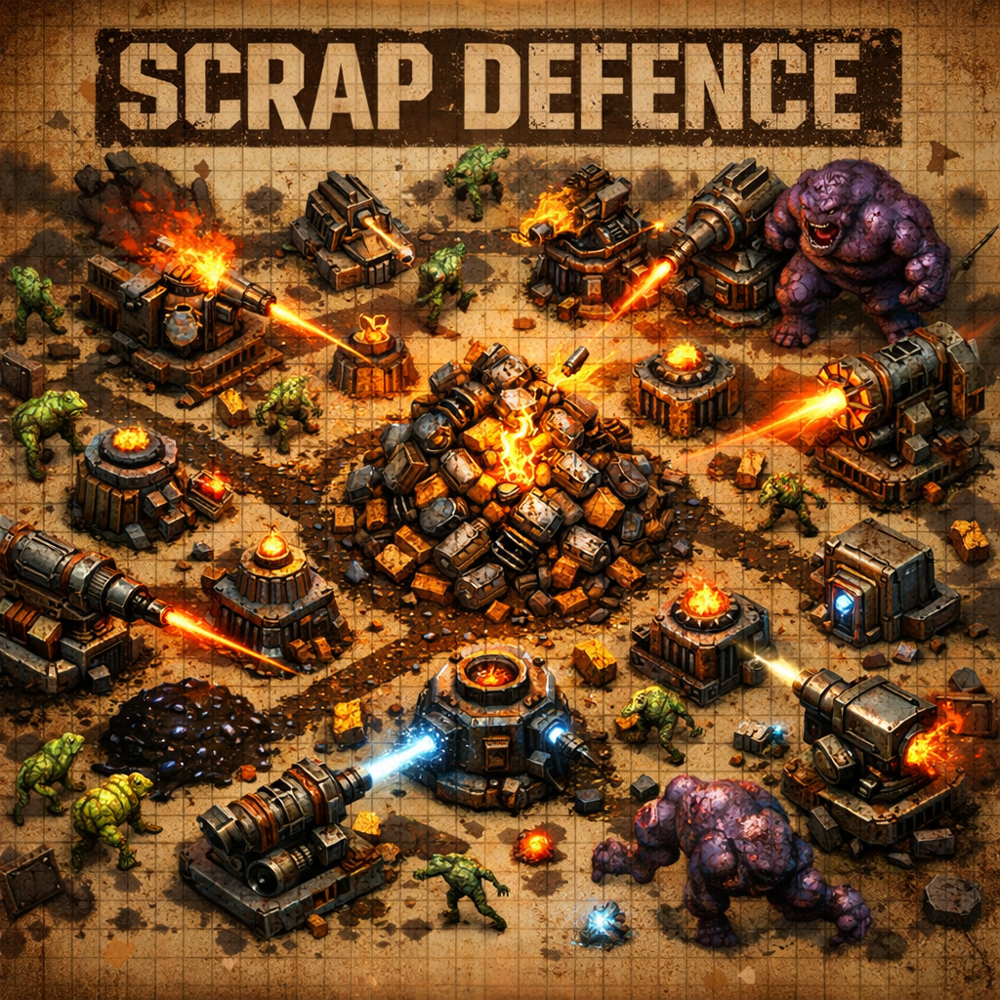

# Bevy TD Sandbox



A post-apocalyptic tower defense game built with Rust and Bevy.

**[Play in your browser on itch.io](https://n8behavior.itch.io/bevy-td-sandbox)** | **[Gameplay Guide](GAMEPLAY.md)**

## Prerequisites

Install [Rust](https://rustup.rs/) and [just](https://github.com/casey/just)
(`cargo install just`), then bootstrap the clone:

```bash
just setup
```

`just setup` is safe to re-run. It installs:

- the native libraries listed below, through your package manager. It
  uses sudo only when a package is missing.
- the `rustfmt` and `clippy` components and the `wasm32-unknown-unknown` target.
- the repo's pre-commit hook (fmt + clippy), via `core.hooksPath`.
- the web tooling: the Bevy CLI and the `wasm-bindgen-cli` version that
  matches `Cargo.lock`. Re-run `just setup` after a `wasm-bindgen` bump.

### System Dependencies

`just setup` installs these for you on Ubuntu/Debian, Fedora, and Arch.
The OpenSSL package is only needed to compile the Bevy CLI for web builds.

**macOS** — Xcode Command Line Tools (`xcode-select --install`).

**Windows** — Visual Studio C++ Build Tools (`rustup` prompts you to install them during Rust setup).

**Linux (Ubuntu/Debian):**

```bash
sudo apt-get install -y libwayland-dev libxkbcommon-dev libasound2-dev libudev-dev libssl-dev
```

**Linux (Fedora):**

```bash
sudo dnf install -y wayland-devel libxkbcommon-devel alsa-lib-devel systemd-devel openssl-devel
```

**Linux (Arch):**

```bash
sudo pacman -S wayland libxkbcommon alsa-lib systemd openssl
```

## Build & Run

```bash
just run       # run the game (dynamic linking for fast recompiles)
just test      # run all tests (unit, integration, doctests)
just ci        # full local CI check (format + clippy + tests)
```

All dev workflows are in the [`justfile`](justfile). Run `just` to see
all available recipes.

<details>
<summary>Raw cargo commands (without just)</summary>

```bash
cargo run -F dynamic   # run with dynamic linking
cargo run              # run without dynamic linking (slower recompile)
cargo check            # fast compile check
cargo clippy           # lint
cargo test --workspace # all tests
cargo fmt              # auto-format
cargo doc --open       # local API docs
```

</details>

## Development

### Feature flags

| Feature    | Contents                                                           | When active                |
|------------|--------------------------------------------------------------------|----------------------------|
| `native`   | `dev` + file/embedded watchers (hot reload)                        | **Default** — desktop dev  |
| `dev`      | [Dev mode](#dev-mode), Bevy dev tools, UI debug, location tracking | Desktop and web dev builds |
| `dynamic`  | `bevy/dynamic_linking` (shared lib linking)                        | Opt-in via `just run`      |
| *(none)*   | Bare dependencies, static linking                                  | Release, web release       |

`just run` automatically adds `-F dynamic` for fast incremental
recompiles. `just test` uses the defaults (no dynamic linking) so
doctests work correctly.

A plain `cargo build --release` keeps the default features, so it
includes dev mode. Build a native release with `--no-default-features`,
or through `bevy build --release`, which turns them off.

### Dev mode

Builds with the `dev` feature show a small "DEV" label in the top-left
corner, with one line for each dev toggle that is on. Dev keys are
F-keys (`F1`–`F10` and `F12`; `F11` is fullscreen), so none is a
gameplay key. On a Mac keyboard, hold Fn.

| Key  | Name     | What it does                                      |
|------|----------|---------------------------------------------------|
| `F1` | Dev keys | Show or hide the list of dev keys and their state |

### Build profiles

| Profile        | Purpose                                       | Key settings                          |
|----------------|-----------------------------------------------|---------------------------------------|
| `dev`          | Local development                             | `opt-level = 1`, deps at `opt-level = 3` |
| `release`      | Native release                                | LTO thin, 1 codegen unit             |
| `web-release`  | WASM release (`bevy build --release web`)     | `opt-level = "s"`, strip debuginfo    |

### Tracing & debugging

Bevy uses the `tracing` crate for logging. Set `RUST_LOG` to see game
diagnostics:

```bash
RUST_LOG=bevy_td_sandbox=debug just run                 # all game diagnostics
RUST_LOG=bevy_td_sandbox::tower=debug just run           # tower placement only
RUST_LOG=bevy_td_sandbox::enemy=debug just run           # enemy spawns & movement
RUST_LOG=bevy_td_sandbox::pathfinding=warn just run      # pathfinding failures & stuck enemies
RUST_LOG=debug just run                                  # everything (very noisy)
```

### Web / WASM builds

The game compiles to WASM for browser play. Web builds require the
`wasm32-unknown-unknown` target and special RUSTFLAGS for `getrandom`.
The [Bevy CLI](https://github.com/TheBevyFlock/bevy_cli) handles this
automatically:

```bash
just web               # dev web build
just web-release       # optimized web bundle
```

The `[package.metadata.bevy_cli.*]` sections in `Cargo.toml` configure
feature flags for each target automatically.

### CI pipeline

A single GitHub Actions workflow (`.github/workflows/ci.yaml`) runs on
every push to `main` and on pull requests. Four parallel jobs:

| Job           | What it checks                                           |
|---------------|----------------------------------------------------------|
| **Format**    | `cargo fmt --check`                                      |
| **Clippy**    | `cargo clippy --all-targets --all-features` (zero warnings) |
| **Test**      | `cargo test --workspace` (unit, integration, doctests)   |
| **Check web** | `cargo check --no-default-features --target wasm32-unknown-unknown` |

Clippy, Test, and Check web each keep their own
[rust-cache](https://github.com/Swatinem/rust-cache) of compiled
dependencies. Only runs on `main` save these caches; pull requests
restore them.

A new push to a pull request cancels that pull request's older run,
but a run on `main` is never cancelled: it finishes and saves its
caches, and only the newest merge made meanwhile waits to run after it.

Run `just ci` locally before pushing to catch issues early.

### Release pipeline

`.github/workflows/release.yaml` triggers when a GitHub release is
published, or on manual dispatch (`workflow_dispatch`). It builds a WASM
web bundle via `bevy build --release web` and keeps it as a workflow
artifact. For a published release it also uploads the bundle to that
release and always pushes it to itch.io. A manual run pushes to itch.io
only when its `upload_to_itch` input is checked (the default).

### Session image

`deploy/session/Dockerfile` is the container image of the riff sessions of
this repository: `riff-base` with a pinned Rust (`rustfmt`, `clippy`, the
`wasm32-unknown-unknown` target), the system libraries of Bevy and `just`, so
a session can run `just ci`. `.github/workflows/session-image.yml` builds it
on each change of `deploy/session/`, pushes it to
`ghcr.io/n8behavior/bevy-td-sandbox-session`, runs `just ci` in it, and
writes the `riff.toml` line with its digest in the run summary. `riff.toml`
pins a digest built on `main`. To take a newer stable Rust, raise
`RUST_VERSION` in the Dockerfile, then pin the new digest.
